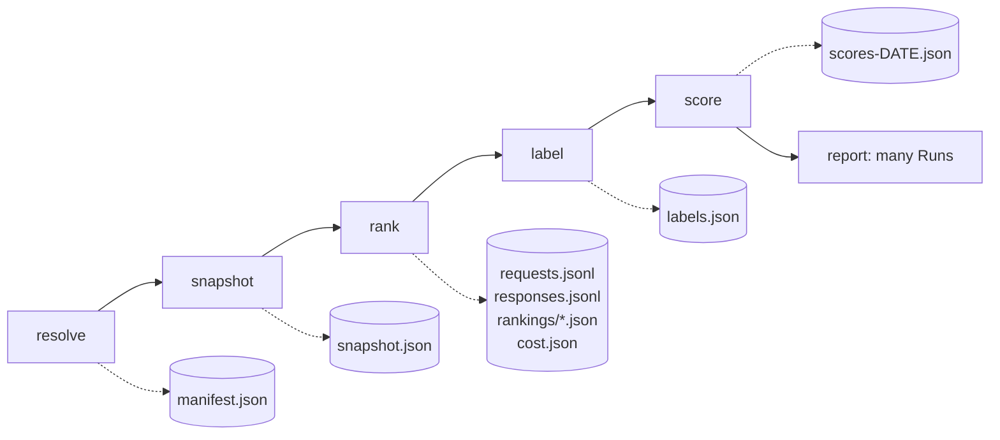
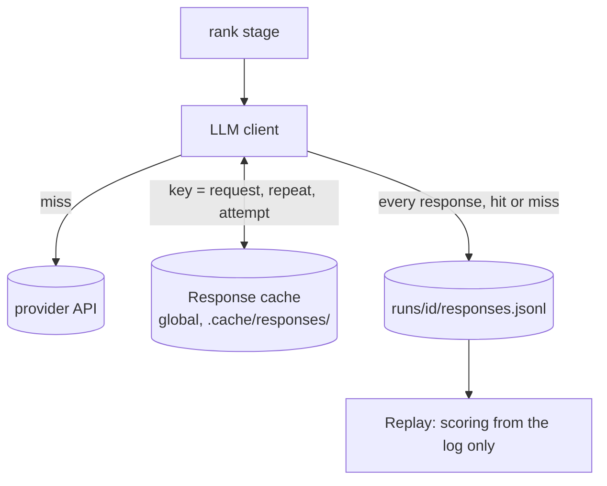

# A Run is five stages that checkpoint as files in its directory

Accepted. Decided in #39. Builds on [ADR 0001](0001-reproducibility-means-replay.md) (Replay, Run directory) and [ADR 0002](0002-single-llm-client-choke-point.md) (client, Response cache, Dry-run). The code layout is [ADR 0009](0009-code-layout-and-core-types.md).

A Run is one (Target repo, Cutoff date) pair: its Baseline and its 3 LLM repeats ([ADR 0005](0005-scoring-pre-registration.md)). Averaging repeats and Cutoff dates, the bootstrap and the verdict happen in `report`, never inside a Run.

## Stages and artifacts

| Stage | Writes into `runs/<id>/` | Notes |
| --- | --- | --- |
| `resolve` | `manifest.json` | Pins the SHA at the Cutoff date. Creates the Run directory. |
| `snapshot` | `snapshot.json` | Eligible files, churn, complexity, and issues as of the Cutoff date (ADR 0004 filters, [ADR 0007](0007-heuristic-baseline-definition.md) inputs). The only stage that reads the Target repo. |
| `rank` | `requests.jsonl`, `responses.jsonl`, `rankings/baseline.json`, `rankings/llm-<n>.json`, `cost.json` | The only stage that calls the LLM. |
| `label` | `labels.json` | Fix commits in `(Cutoff date, Cutoff date + 6 months]`. Refuses until the window has closed. |
| `score` | `scores-<scoring-date>.json` | Every ADR 0005 metric for this one Run. Refuses until `label` is done. A re-score writes a new file and never overwrites an earlier one. |

`report` is a separate command over many Runs. It writes the committed summaries, not files inside a Run.

## Manifest

Written once, atomically, by `resolve`, and never changed. It holds only inputs: the model snapshot and its training cutoff `K` with `C - K` ([ADR 0006](0006-target-repos-and-cutoff-dates.md)), the prompt template hashes, the Pinned SHA, the Cutoff date, the repeat count, the `lizard` version, the commit SHAs of ADR 0005 and ADR 0007, and the tool's own git SHA.

Actual spend lives in `cost.json`, and the scoring date in the name of each `scores-<scoring-date>.json`, because neither is known when the Manifest is written. The Run directory name is `<UTC-timestamp>-<8 hex of sha256 over the canonical manifest.json>`, and that name is the Run id.

This amends the Label lag row of [ADR 0006](0006-target-repos-and-cutoff-dates.md): the scoring date is recorded in the `scores-<scoring-date>.json` name, not in the Manifest. `report` treats the earliest scoring on or after 2027-01-31 as primary, and any later one as the sensitivity check ADR 0006 describes.

## Resume

- **A stage is done when its final artifact exists.** Artifacts are written to a temporary file and renamed, so a crash leaves either the whole file or none. Resume skips done stages and does not compare input hashes, because the Manifest is immutable and the directory is tied to it.
- **`rank` resumes per ranking.** It writes one ranking per (ranker, repeat) and re-sends only the missing ones.
- **A Run's state is derived from its artifacts:** resolved (`manifest.json`, and anything short of planned), planned (plus `snapshot.json` and `requests.jsonl`), ranked (plus `rankings/*`), scored (plus `labels.json` and at least one `scores-*.json`). A `status` command prints it. There is no marker file.
- **State and the next stage are derived in one place.** `RunDir.state()` gives the state, `RunDir.next_stage()` gives the first stage that is not done (`None` when all are), and `RunDir.missing_rankings()` gives the (ranker, repeat) pairs `rank` still has to produce. `status` and `resume` share them, and nothing else inspects artifact files to decide what to run.
- **A Dry-run is a planned Run.** It runs `resolve` and `snapshot`, writes `requests.jsonl` and a cost estimate, and stops before sending. `resume <id> --run` continues the same directory into real calls, so the estimate is what the real Run sends.
- **Repeating a Run** means starting a new one, which gets a new directory.
- **`--max-usd` is not in the Manifest.** It is an invocation parameter that caps the Run's total spend, with `cost.json` accumulating across resumes. Each attempt logs the cap it ran under. Resuming past the cap needs a higher `--max-usd`.
- **No `--provisional` scoring.** `label` and `score` refuse on an open window. Pipeline testing uses past Cutoff dates whose windows have closed. Add a provisional mode only if that proves insufficient.
- **No schema migrations.** The Manifest records the tool's git SHA, so an old Run is replayed by checking out that SHA.

## Cache layers

| Layer | Where | Purpose |
| --- | --- | --- |
| Response cache | Global, outside any Run | Never pay twice for an identical request. Resume of a crashed `rank` is cheap because of it. |
| `responses.jsonl` | In the Run | The self-contained record. Cache hits are copied in, so Replay reads only the Run directory and never the cache. |
| Stage artifacts | In the Run | The checkpoints. There is no per-call checkpoint beyond the cache. |

- **The repeat index is part of the cache key** and of the request record, but is not sent to the API. The 3 repeats send identical requests, and a key without it would return one response three times, silently turning 3 repeats into 1. Claude Sonnet 5.5 rejects non-default `temperature`, `top_p` and `top_k` (a 400), and every model does from 2026-10-21, so the repeats are samples at the API's default sampling settings, not temperature 0 (see Known limits). A new Run reuses cache entries only for identical (request, repeat) pairs.
- **Unparsable output** is always logged raw. The client retries once with an `attempt` index in the cache key, because a cache would otherwise return the same bad response forever. If it is still unparsable, `rank` fails loudly and stays resumable. A failed repeat is never silently scored as an empty ranking.

## Issues in the snapshot

ADR 0005 lets both rankers see issues as of the Cutoff date. Issue state is rebuilt from `created_at` and the timeline. An issue whose body was edited after the Cutoff date, or whose edit history cannot be checked, is excluded and counted in the Run's report. Otherwise a later edit such as "root cause was `parse.py`" would leak the answer to the LLM.

## Why

- **Files, not a database or a state file.** Artifacts are the checkpoints, so state cannot disagree with them, and a Run can be inspected with `ls`.
- **One Run per (repo, Cutoff).** It is the unit ADR 0005 aggregates over, and a failure costs one pair, not the experiment.
- **Immutable Manifest.** Committed summaries cite its hash and the Run id derives from it, so it can't change after `resolve`.

## Known limits

- A Dry-run directory and a real Run that crashed before its first call look the same. Both are planned and resume the same way.
- Abandoned Dry-run directories accumulate in the gitignored `runs/`.
- An old Run can be replayed only by old code.
- Excluding issues edited after the Cutoff date removes some legitimate context, and the excluded count shows how much.
- ADR 0005 specifies "3 LLM repeats at temperature 0", which the API no longer allows. This ADR does not change ADR 0005. It is amended by [ADR 0012](0012-llm-repeats-use-default-sampling.md): the repeats are default-sampling draws, the variation they measure is larger, and the "Repeats at temperature 0" rationale no longer holds.
- The unverified part of the issue rebuild is the edit history. REST returns only the current body, and GraphQL `userContentEdits` was not checked against public repos. The snapshot spike must confirm it, or fall back to excluding every issue it cannot prove clean.

## Alternatives rejected

- **A mutable Manifest that gains cost.** It changes the hash the summaries cite, or forces a hash that skips one field.
- **A separate scoring Run pointing at the ranking Run.** It splits one experiment unit across two directories for no gain.
- **A `--provisional` flag now.** It tempts early peeking at a real repo before it is needed. Past Cutoff dates cover pipeline testing.
- **A `dry_run` marker or `runs/dry/`.** A second source of truth, and promotion needs a mutation or a move.
- **Dropping issue text from the prompt.** The safest, but it changes the experiment ADR 0005 describes.
- **Excluding issues by `updated_at`.** Any later comment bumps it, so most long-lived issues would go.

## Amendments

- 2026-11-24: The issue-history spike (#73) resolved the last Known limit. GraphQL `userContentEdits` and `lastEditedAt` are readable on a public repo with any authenticated token, and `lastEditedAt` is the time of the newest body edit. The snapshot keeps an issue only when `lastEditedAt` is empty or before the Cutoff date, every fetched edit is before it, and the edit and rename histories were fetched in full (the first 100 entries; a longer history counts as unprovable). Otherwise it excludes the issue and counts it in `snapshot.json` as `excluded_issues`. An issue created on or after the Cutoff date does not exist yet and is dropped without being counted. The title comes from the rename events. `snapshot --no-issues` skips the GitHub calls and sets `issues_collected` to false. Title edits and comment edits are not body edits, so only renames are replayed.
- 2026-11-25: The `resume <id>` command (#78) runs the stages that are not done and stops after `snapshot`, which makes the Run a Dry-run. `resume <id> --run` continues the same directory through `rank` and `label`; `score` joins the list in `run/stages.py` when its stage lands. Until the LLM rank stage (#88) exists, nothing writes `requests.jsonl` or LLM rankings, so `run_dir.LLM_RANKING` is False and the Run rules above are relaxed: a Run is planned once `snapshot.json` exists, and `rank` is done when `rankings/baseline.json` exists. Setting `LLM_RANKING` to True restores the rules as written, including `requests.jsonl` for planned and the LLM rankings for ranked.
