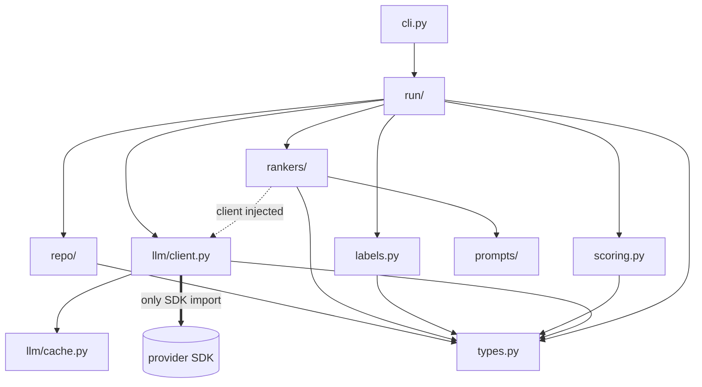

# Code layout: leaf modules over plain types, one place for Run files

Accepted. Decided in #39. The stages and artifacts are in [ADR 0008](0008-pipeline-stages-artifacts-and-resume.md). The LLM client's rules are [ADR 0002](0002-single-llm-client-choke-point.md).

This fixes where code lives and which way dependencies point. It does not fix function signatures. The `Ranker` protocol's exact shape follows from the LLM ranker ticket, and the baseline, labeling and scoring APIs follow from theirs.

## Layout

| Module | Holds |
| --- | --- |
| `types.py` | Core types only. Imports nothing else from the package. |
| `llm/client.py` | The only SDK import ([ADR 0002](0002-single-llm-client-choke-point.md); this is the path `CLIENT_MODULE` in the policy test names). |
| `llm/cache.py` | The Response cache, used by the client. |
| `repo/` | All access to the Target repo as of the Cutoff date: `git.py` (the only code that shells out to `git`), `complexity.py` (`lizard`), `issues.py`, and file filtering. The Leakage test therefore guards one place. |
| `rankers/` | `base.py` holds the `Ranker` protocol. `baseline.py` and `llm.py` sit beside it. The LLM ranker gets the client injected and owns the pure prompt builder. |
| `prompts/` | Plain text templates. The Manifest records their hashes. |
| `labels.py`, `scoring.py` | Pure functions over `types`. |
| `run/` | The Run directory, Manifest, stage functions and resume. The only code that touches Run files. |
| `cli.py` | `resolve`, `snapshot`, `rank`, `label`, `score`, `resume`, `status`, `report`. |

`tech_debt_miner` never imports `gate`. `gate` is dev tooling that ships in the same wheel, and the two stay independent. Tests mirror this layout, as [CONTRIBUTING.md](../../CONTRIBUTING.md#testing) says.

## Rules

- **Dependencies point inward.** `run/` and `cli.py` may import everything. Leaf modules import only `types`, plus `llm/client.py` where a leaf needs the client. No policy test enforces this beyond ADR 0002's; add one if layering slips.
- **Stages are plain functions** `(run_dir, deps) -> None`, in an ordered tuple in `run/stages.py`. There is no framework and no `Stage` class. `deps` is a small dataclass of injected collaborators: the client, a clock and a git runner.
- **One `RunDir` class** owns every artifact path and does the atomic writes. Serialization lives beside it in `run/store.py`, so the types stay pure data.
- **Core types** are frozen stdlib dataclasses: `Manifest`, `FileFacts` (path, LOC, churn, complexity), `Snapshot` (files and issues), `Request`, `Ranking` (ranker id, repeat, ordered paths), `Labels` (path to count) and `Scores`. `Request` holds everything the cache key needs. Artifacts are plain JSON, and per-call logs are JSONL (one JSON object per line, so a crash damages at most the last line). There is no pydantic dependency.
- **One prompt builder** is shared by Dry-run and real Runs. Dry-run skips only the send, so the Leakage test inspects the real prompts.
- **Target repos** are cloned once into a gitignored `repos/<name>/` and treated as read-only. `snapshot` exports the Pinned SHA with `git archive` into a temporary directory for `lizard` and deletes it. A Run directory keeps no tree, and Replay never needs the repo.
- **Experiment inputs** are explicit CLI arguments (`--repo`, `--cutoff`, the model and the rest). There is no config file listing the Target repos; the list stays in ADR 0006.

## Why

- **Leaf modules over plain types** keep scoring, labeling and ranking testable without a Run, a repo or a client.
- **Everything that reads the repo is in `repo/`**, so the Leakage test has one place to check.
- **One owner of Run files** means artifact names and atomic writes are defined once.
- **Frozen stdlib dataclasses** need no dependency, and `pyright` strict checks them.

## Known limits

- The `Ranker` protocol, and the baseline, labeling and scoring signatures, are deliberately open.
- Layering is a convention until a policy test enforces it.
- Splitting `repo/` further, or moving `prompts/` next to `rankers/llm.py`, is cheap later and not decided here.

## Addendum: pure git history rules

The "git runner" in `deps` is not a separate collaborator. `repo/git.py` is the only code that runs `git`, and it keeps one private subprocess runner. Parsing (`repo/history.py`) and the Cutoff date rules (`repo/cutoff.py`) are pure functions over parsed commits, so the boundary rules are unit tested without a repo. This is not a new seam: real git is the only adapter. Pinning reads the whole commit graph with one `git log` and trades memory on very large repos for a bounded number of git calls.

## Alternatives rejected

- **A `Stage` class hierarchy or plugin registry.** Five fixed stages do not need one.
- **Types that serialize themselves.** It couples every leaf module to the on-disk format.
- **pydantic.** A dependency for validation the tool does not need, since it only reads files it wrote.
- **A config file of Target repos.** ADR 0006 already freezes the list, and a batch runner can come later.

## Amendments

- 2026-11-24: [ADR 0015](0015-run-artifacts-are-a-codec-table.md) refines the "One `RunDir` class" rule. `RunDir` still owns every artifact path and does the atomic writes; its interface is now `read`, `write`, `append` and friends over the artifact table in `run/artifacts.py`.
- 2026-11-24: Two rules are relaxed. A leaf module may import `types` and the pure `repo` modules (`history`, `cutoff`, `eligibility`), never `repo/git.py` or anything that runs a subprocess; `tests/policy/test_layering.py` enforces this for the leaf modules that conform today. And the `label` stage fast-forwards its Target repo clone before reading it (fast-forward only, skipped with `--no-fetch`), because a clone made at `resolve` time lacks the closed Label window; `labels.json` records the clone's HEAD, its newest commit date and whether an update ran.
